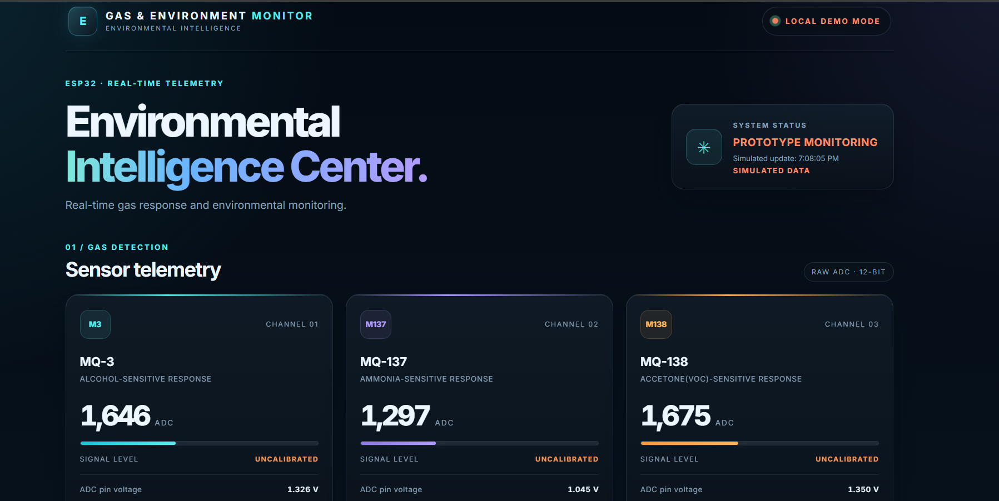
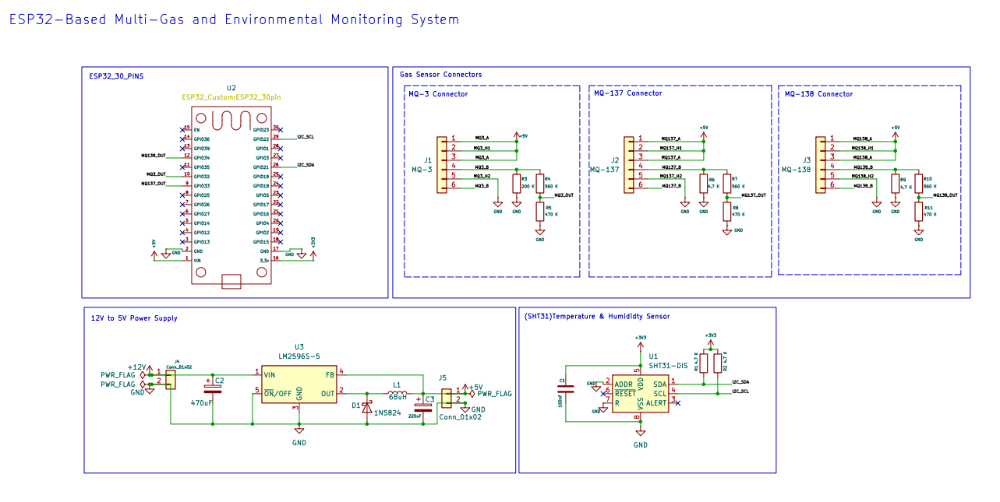
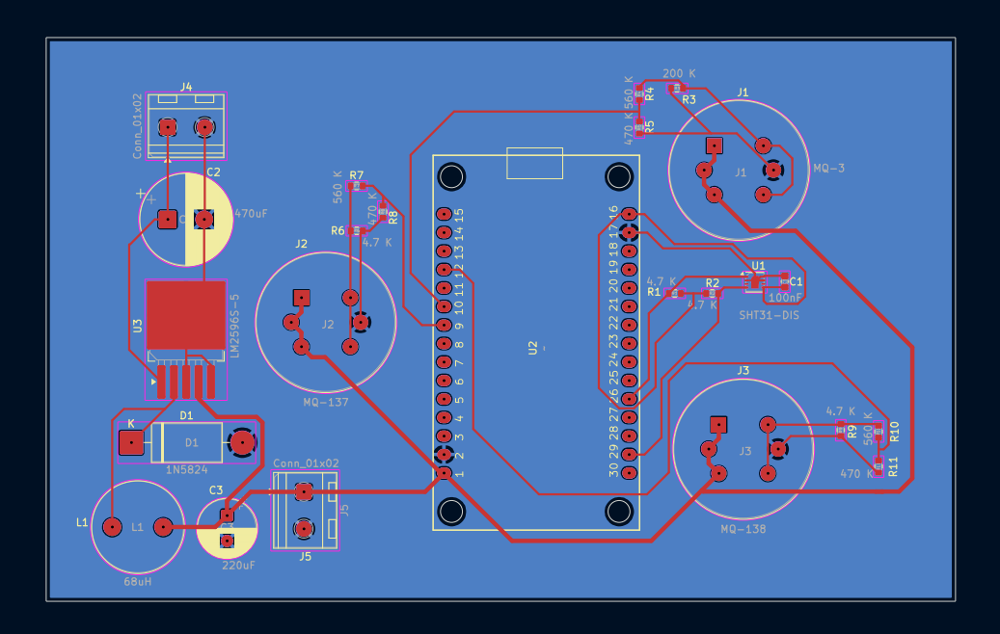

# Nexus Monitor — ESP32 Gas & Environmental Monitoring System

An ESP32-based embedded IoT project integrating multi-gas sensing, temperature and humidity monitoring, custom PCB design, and a web-based monitoring dashboard.

<p align="center">
  <strong>Embedded Systems · IoT · PCB Design · Sensor Integration</strong>
</p>

---

## Overview

**Nexus Monitor** is an ESP32-based gas and environmental monitoring system designed to acquire sensor readings and present monitoring data through a web interface.

The system integrates MQ-series gas sensors, an SHT31 temperature and humidity sensor, ESP32 analog and I²C interfaces, Wi-Fi connectivity, an HTTP API, and a web dashboard. The hardware design includes a custom circuit schematic and PCB layout created using KiCad.

The project combines embedded firmware development, electronic circuit design, sensor interfacing, and web technologies in a single platform.

## Key Features

- **Multi-gas sensing:** Interfaces with MQ-3, MQ-137, and MQ-138 gas sensor modules.
- **Environmental monitoring:** Uses the SHT31 sensor for temperature and relative humidity measurements.
- **ADC acquisition:** Reads analog signals from gas sensor modules through the ESP32 ADC.
- **I²C communication:** Interfaces with the SHT31 sensor.
- **Wireless connectivity:** Supports ESP32 Wi-Fi access point operation.
- **HTTP API:** Makes sensor data available to the web interface.
- **Web dashboard:** Displays sensor telemetry using HTML, CSS, and JavaScript.
- **LittleFS integration:** Supports storing web assets in the ESP32 flash filesystem.
- **Custom PCB design:** Includes circuit schematic development and PCB layout in KiCad.
- **PlatformIO workflow:** Supports firmware building and uploading through PlatformIO.

## Project Screenshots

### Web Dashboard



*Dashboard interface displaying simulated sensor readings in local demo mode. These values are illustrative and are not confirmed live hardware measurements.*

### Circuit Schematic



*Circuit design showing the ESP32 development board, MQ-series gas sensor connectors, SHT31 interface, and LM2596-based power supply.*

### PCB Layout



*PCB layout showing the ESP32 footprint, gas sensor connectors, power supply components, and routed connections.*

## Hardware Components

| Component | Purpose |
|---|---|
| ESP32 DevKit | Main microcontroller and Wi-Fi connectivity |
| MQ-3 gas sensor | Gas-sensing input |
| MQ-137 gas sensor | Gas-sensing input |
| MQ-138 gas sensor | Gas-sensing input |
| SHT31 sensor | Temperature and relative humidity measurement |
| LM2596-based buck converter | DC-DC power conversion circuit |
| Passive components | Filtering, voltage conditioning, and circuit support |
| Custom PCB | Integration of the microcontroller and sensor interfaces |

*Verify component variants and circuit ratings against the actual schematic and datasheets before assembling or powering the hardware.*

## Software and Technologies

- **Programming:** C, C++, Embedded C
- **Microcontroller:** ESP32
- **Framework:** Arduino
- **Build system:** PlatformIO
- **Sensor libraries:** Adafruit SHT31 Library, Adafruit BusIO
- **Communication:** ADC, I²C, Wi-Fi, HTTP
- **Web development:** HTML5, CSS3, JavaScript
- **Embedded filesystem:** LittleFS
- **Electronic design automation:** KiCad
- **Version control:** Git and GitHub
- **Deployment:** Vercel for the existing web dashboard

## System Architecture

```text
 MQ-3 Gas Sensor ─────┐
 MQ-137 Gas Sensor ───┼──> ESP32 ADC ────────┐
 MQ-138 Gas Sensor ───┘                      │
                                             │
 SHT31 Sensor ─────────── I²C ───────────────┤
                                             ▼
                                    ESP32 Firmware
                                             │
                                      Wi-Fi / HTTP
                                             │
                                             ▼
                                       Web Dashboard

 LM2596 Power Supply ─────> Power Rails
 KiCad Schematic ─────────> PCB Layout
```

The ESP32 firmware handles sensor acquisition and communication. The dashboard presents data supplied by the configured interface. Actual live monitoring depends on the firmware, API, and dashboard being correctly integrated and running.

## Repository Structure

```text
esp32-monitor/
├── src/
│   └── main.cpp
├── include/
├── lib/
├── test/
├── data/
│   ├── app.js
│   ├── index.html
│   └── style.css
├── docs/
│   └── images/
│       ├── schematic.png
│       ├── pcb-layout.png
│       └── dashboard.png
├── hardware/
│   ├── README.md
│   ├── *.kicad_pro
│   ├── *.kicad_sch
│   └── *.kicad_pcb
├── app.js
├── index.html
├── style.css
├── platformio.ini
├── .gitignore
└── README.md
```

The `hardware/` directory should contain the actual KiCad project files. The screenshot paths under `docs/images/` must match the uploaded filenames.

The root-level dashboard files are retained for the existing web deployment, while the `data/` directory is used for assets intended for the ESP32 LittleFS filesystem.

## Getting Started

### Prerequisites

Install the following tools:

1. [Visual Studio Code](https://code.visualstudio.com/)
2. [PlatformIO IDE](https://platformio.org/install/ide?install=vscode)
3. USB drivers appropriate for your ESP32 development board
4. Git, for cloning and version control

### Clone the Repository

```bash
git clone https://github.com/nivedrajeeshvp/esp32-monitor.git
cd esp32-monitor
```

### PlatformIO Configuration

The project configuration uses the ESP32 DevKit board and the Arduino framework.

```ini
[env:esp32dev]
platform = espressif32
board = esp32dev
framework = arduino

monitor_speed = 115200
board_build.filesystem = littlefs

lib_deps =
    adafruit/Adafruit SHT31 Library
    adafruit/Adafruit BusIO
```

### Build the Firmware

Open the project in VS Code with PlatformIO installed, connect the ESP32 board, and run:

```bash
pio run
```

### Upload the Firmware

Select the correct serial port and upload the compiled firmware:

```bash
pio run --target upload
```

### Upload LittleFS Assets

Place the web assets intended for the ESP32 filesystem in the `data/` directory. Then build and upload the filesystem image:

```bash
pio run --target buildfs
pio run --target uploadfs
```

**Note:** Uploading a new filesystem image replaces the contents of the device's existing LittleFS partition.

### Monitor Serial Output

```bash
pio device monitor
```

The configured serial baud rate is 115200.

## PCB Design

The hardware design is developed using KiCad and includes:

- ESP32 development board connections
- MQ-series gas sensor connectors
- SHT31 temperature and humidity sensor interface
- LM2596-based DC-DC power supply circuit
- Component footprints and PCB routing

The native KiCad files allow the schematic and board layout to be inspected and modified.

Before PCB fabrication, verify component footprints, connector pinouts, trace clearances, current requirements, power ratings, and the regulator circuit against the selected components' datasheets.

## Calibration and Safety

- MQ-series sensors require appropriate preheating and calibration according to their datasheets and intended applications.
- Raw ADC readings are not equivalent to calibrated gas concentrations in ppm.
- Do not report gas concentration values without an appropriate calibration method.
- Verify that every sensor output is compatible with the ESP32 ADC input voltage limits.
- Check the regulator input range, output voltage, current capacity, thermal performance, and component ratings before powering the circuit.
- This prototype should not be treated as a certified gas safety alarm or a replacement for industrial safety equipment.

## Current Project Status

**Development status: In progress.**

The repository includes ESP32 firmware configuration, sensor-interface development, web dashboard assets, and hardware design work.

The dashboard screenshot represents local demo mode with simulated data. Hardware integration, sensor calibration, live end-to-end operation, and PCB validation should only be marked complete after the corresponding tests have been performed.

## Future Improvements

- Complete hardware integration and validate sensor readings.
- Implement and verify the live sensor-data connection between firmware and dashboard.
- Add calibrated gas-concentration estimation where supported.
- Improve measurement filtering and sensor calibration.
- Add historical data logging and trend visualization.
- Document pin mappings, wiring, and the bill of materials.
- Include PCB fabrication outputs after design verification.
- Add firmware build checks and testing documentation.

## Author

**Nived Rajeesh V P**

- GitHub: [@nivedrajeeshvp](https://github.com/nivedrajeeshvp)
- Repository: [esp32-monitor](https://github.com/nivedrajeeshvp/esp32-monitor)
- Live dashboard: [ESP32 Monitor](https://esp32-monitor-eight.vercel.app/)

## License

No license has been specified yet. Add a suitable open-source license if you intend to permit others to reuse, modify, and distribute this project.
